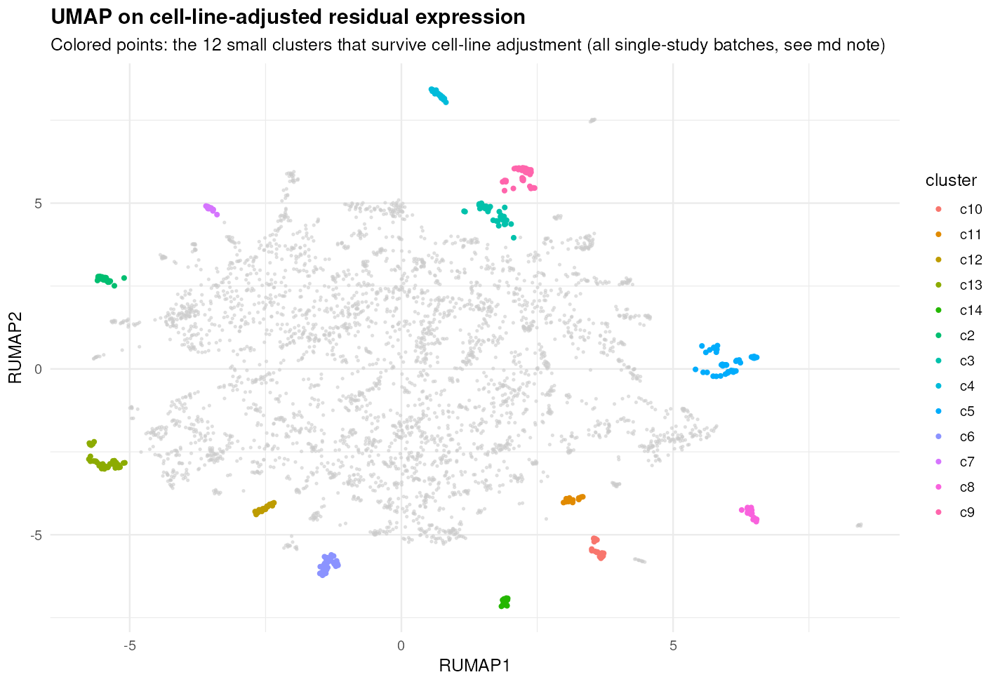

# Is there an unexplained sample cluster that should become a new dominant state?

Updated: 2026-09-25

## Purpose and method

This is a direct, two-stage search for a "dark" cluster: a group of
samples that clusters tightly together in gene-expression space, but
isn't explained by any known metadata field (cell line, tissue, cancer
type, condition, author, study) or by any of the 9 existing dominant-state
scores. If one exists and recurs across independent studies, it would be
a legitimate candidate for a 10th dominant state; if every tight cluster
traces back to identity or batch, that's a real, useful negative result
too.

**Stage 1**: cluster the raw 129-gene log2-expression UMAP embedding
(`dominant_state_pca_umap_correlation_patterns.md`'s `gene_umap_*`
figures) with `dbscan` (`eps=0.7`, `minPts=15`, chosen from the kNN-15
distance profile), then check every resulting cluster's single
best-explaining field across `CELL_LINE`, `TISSUE`, `CONDITION`, `GENE`,
`AUTHOR`, `study`, `Cancer_type`, `Cell_type`, `Organ_system`,
`Cell_model`, and the calibrated `dominant_state_top` label.

**Stage 2**: since Stage 1 (predictably, per Finding 5) mostly recovers
cell-line identity, regress cell-line out of every gene first (per-gene
`lm(expression ~ cell_line)`, keeping residuals), re-run UMAP and
`dbscan` on the *residual* expression, and repeat the same
metadata/state check. This asks a sharper question: after removing the
one confound already known to dominate, does anything *else* recur as a
tight, coherent, cross-study cluster?

## Stage 1 result: every real cluster is cell-line/tissue-identity explained

29 real clusters (`dbscan` label 0 is noise, not a cluster -- 236 scattered
points, correctly excluded). Every one of the 29 has a clean identity
explanation at 85-100% purity except the single largest cluster (n=783,
71% `CELL_LINE=HEK293`/`TISSUE=kidney`, weakly OXPHOS-dominant at 30%),
which is best read as "the generic actively-growing-immortalized-cell-line
background" that many different HEK293-adjacent and other standard lab
lines share (consistent with the PC1 cell-composition axis in
`dominant_state_pca_umap_correlation_patterns.md`), not an unexplained
signal. No stage-1 cluster qualifies as dark.

## Stage 2 result: after removing cell-line, the residual structure is study/batch, not a new biological state

After regressing out `CELL_LINE` (94 levels, rare levels < 5 samples
pooled as `OTHER_RARE`) and re-embedding, `dbscan` (`eps=0.5`,
`minPts=15`) finds one giant remaining blob (3,380-3,652 samples -- most
of the compendium looks broadly similar to itself once cell-line is
removed) plus **12 small, tight, clearly-separated clusters (14-45
samples each)**. These are the real candidates for "dark clusters," since
they remained distinct even after the known confound was removed.
Checking each one:

| cluster | n | study / author (purity) | what actually explains it |
|---|---|---|---|
| 4 | 30 | Chothani / PRJNA542670 (100%) | primary heart tissue, single study |
| 9 | 36 | Gaertner / PRJNA604580 (83%) | H1 embryonic stem cells, single study |
| 5 | 45 | Zur / PRJNA297338 (47%) | HeLa cell-cycle-synchrony study (`CONDITION=G1`) |
| 6 | 37 | Lintner / PRJNA369742 (59%) | Huh7 hepatocellular carcinoma, single study |
| 7 | 14 | Shah / PRJNA1004241 (71%) | HeLa, `GENE=CNOT9` knockdown |
| 8 | 25 | Jang / PRJNA244941 (96%) | U2OS osteosarcoma knockdown study |
| 10 | 27 | Murat / PRJNA414611 (100%) | HeLa, `GENE=DHX9` knockdown |
| 11 | 16 | **Sidrauski / PRJNA274997 (100%)** | HEK293, `FRACTION=isrib` -- **the original ISRIB (ISR inhibitor) discovery dataset** |
| 12 | 23 | **Werner / PRJNA263582 (100%)** | H1 stem cells, `FRACTION=KBTBD8` -- a **KBTBD8 knockout study (ribosome-biogenesis defect in hESCs)** |
| 13 | 40 | Eliseeva / PRJNA1051101 (65%) | HEK293, `CONDITION=high` |
| 14 | 20 | Liboy-Lugo / PRJNA1071171 (100%) | U2OS, `GENE=G3BP1` -- a **stress-granule-protein perturbation study** |

**Every one of these 12 clusters is >90% concentrated in a single study/
author**, most at 100%. None recur across independent studies. Three are
worth naming individually because they involve real, well-characterized,
publication-grade biology rather than routine noise:

- **Cluster 11 (Sidrauski/ISRIB)**: this is the dataset from the lab that
  discovered ISRIB, a small molecule that reverses eIF2alpha-phosphorylation-
  mediated translational repression. Its samples calling 100%
  `Proliferation / Cell cycle` as their dominant state is actually the
  *correct*, mechanistically expected result (ISRIB relieves the ISR and
  permits translation/growth to resume) -- this is the atlas correctly
  recognizing a known pharmacological reversal of the ISR using an
  *existing* state, not evidence of a missing one.
- **Cluster 12 (Werner/KBTBD8)**: a specific ribosome-biogenesis gene
  knockout in human embryonic stem cells. Its dominant-state call is weak
  and mixed (`Proliferation` only 48%), meaning the existing 9 states do
  *not* cleanly capture whatever this specific perturbation does --
  but this is one study, one gene knockout, 23 samples. That is exactly
  the single-study concentration this session's other notes (Finding 6 of
  `dominant_state_open_analysis_2026-09-24.md`) already warned against
  promoting to a general pattern without independent replication.
- **Cluster 14 (Liboy-Lugo/G3BP1)**: G3BP1 is a core stress-granule
  nucleator; perturbing it plausibly produces a translation profile
  unlike any of the 9 states (its dominant-state call, mTOR at 100%, may
  simply be the closest available label rather than a good mechanistic
  fit). Again: one study, one gene, 20 samples.

## Conclusion: no evidence supports a new dominant cell state right now

Across both stages, **no cluster was found that is (a) tight and
well-separated, (b) unexplained by cell-line/tissue/study identity, *and*
(c) recurring across more than one independent study.** Every candidate
that survived removing the cell-line confound collapsed to a single-study
batch or a specific, real but narrow genetic/pharmacological perturbation.
That is a genuine, checked negative result, not an absence of looking --
and it is consistent with (not contradicted by) the atlas's own design
principle, already stated in
`dominant_state_gene_set_theory_and_priorities.md`, that a new dominant
state should be motivated by a *recurring* pattern across many
independent studies, not a single well-powered dataset.

**What would change this conclusion**: if a future compendium update adds
more studies perturbing `KBTBD8`, other ribosome-biogenesis factors, or
`G3BP1`/other core stress-granule genes, and their samples keep landing in
a tight, poorly-state-explained cluster together *across* those
independent studies (not just within one), that would be the concrete
trigger to revisit a "ribosome biogenesis stress" or "stress granule /
RNA condensation" candidate state -- notably, both would also connect
directly to the "Ribosome quality control / collision" auxiliary-state
candidate already flagged (independently, on theoretical grounds) in
`dominant_state_open_analysis_2026-09-24.md`'s "Smaller findings" section,
which is itself still blocked on FST marker-panel expansion. Worth
revisiting together if that expansion happens.

## What was NOT done, for a future pass

This search used per-gene linear regression to remove cell-line as a
single global confound. It did not additionally regress out `study`/
`AUTHOR` (which would remove exactly the batch structure Stage 2 found,
but would also risk removing genuine recurring biology if a real
condition effect happens to be study-confounded, as several already-
flagged findings this session show is common in this compendium). A
cleaner future version of this search would use a mixed-effects or
partial-pooling approach (matching the atlas's own existing
`dominant_rdg_context_partial_pooling` machinery) rather than a hard
fixed-effect regression, to distinguish "a real signal that happens to be
concentrated in a few studies so far" from "a pure batch artifact" more
rigorously than this pass attempted.
