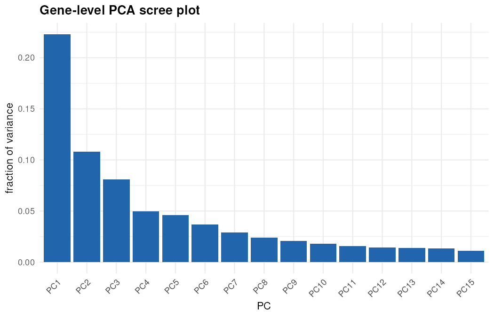
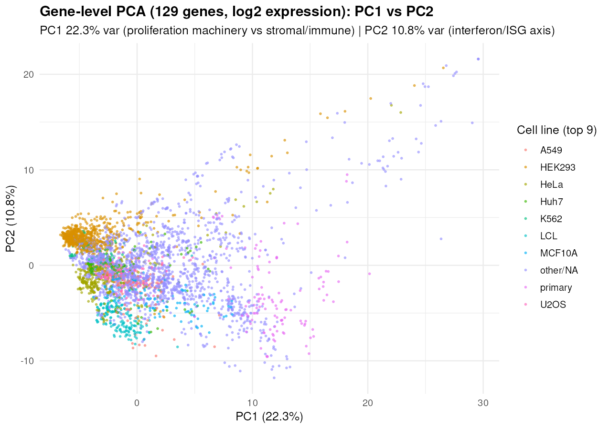
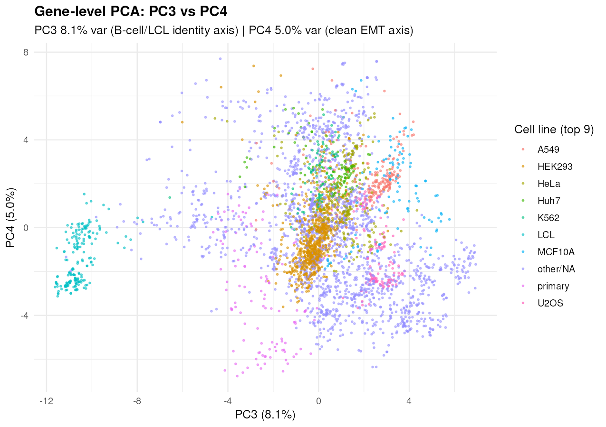
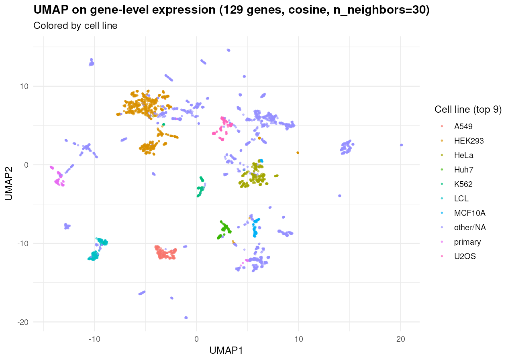
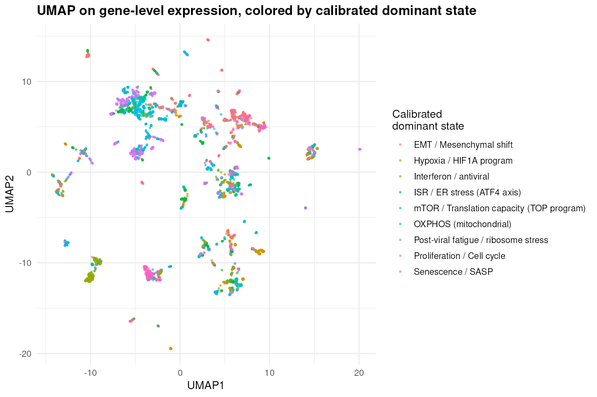
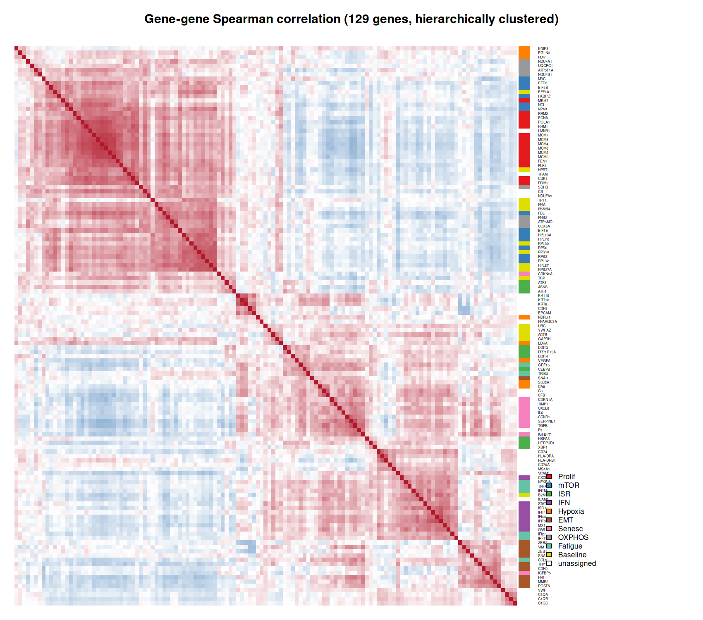
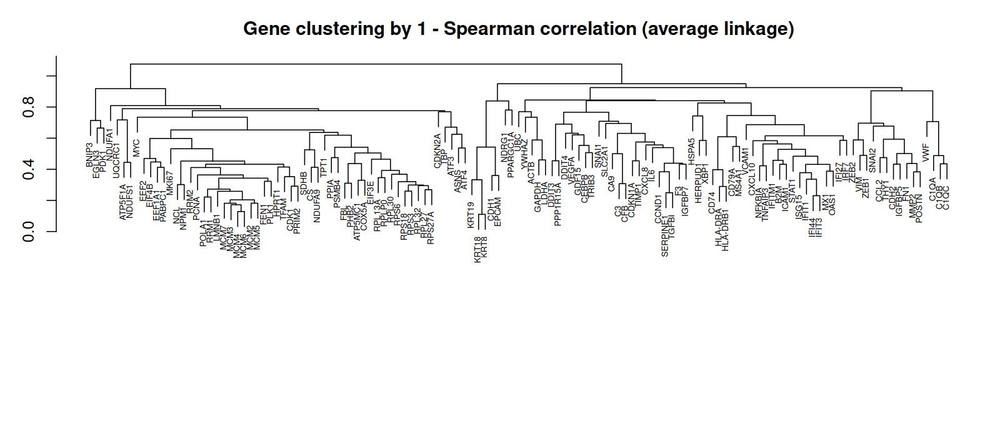

# PCA, UMAP, and gene-gene correlation structure in the dominant-state atlas

Updated: 2026-09-25

## Purpose

`dominant_state_open_analysis_2026-09-24.md`'s Finding 5 established, via the
pipeline's own existing state-score PCA and glmnet metadata regression, that
most explainable dominant-state variance is cell-line/batch identity rather
than treatment. This note asks the same underlying question with a
different, complementary toolkit, applied directly to the **129-gene raw
expression matrix** (not the 9 aggregated state scores): PCA, UMAP, and
gene-gene correlation clustering. All of it is new analysis computed fresh
for this note (code in the companion scratch scripts, not yet promoted to
`scripts/`), using `human_dominant_cell_states_clean_cds_gene_expression.csv`
(129 genes x 3,857 samples, log2-transformed) joined to the calibrated
per-sample dominant-state label
(`human_dominant_state_activity_metadata.fst`) and sample metadata.

Three things came out of this that are new relative to the existing note:
(1) at raw-gene resolution, cell-line identity is not just statistically
dominant but forms near-perfectly discrete, visually separated islands in
UMAP space, with some cell lines showing extreme dominant-state-calling
bias; (2) gene-gene correlation clustering reveals a clean two-supercluster
architecture that **splits the ISR module's own marker genes across both
superclusters**, mapping onto the known early-adaptive vs.
late-terminal phases of the unfolded protein response; (3) the EMT module's
mesenchymal pole correlates more with stromal/macrophage/vascular genes than
with a clean "cancer cell EMT" signature.

## Gene-level PCA: a different top axis than the state-score PCA

PCA directly on the 129 x 3,857 log2 expression matrix (centered and
scaled) finds substantially more diffuse variance than the 9-state-score
PCA in the existing note (expected: 129 raw genes are noisier and higher-
dimensional than 9 pre-aggregated scores): **PC1 explains 22.3%,
PC2 10.8%, PC3 8.1%, PC4 5.0%** (58% total in the first 8 PCs; see
`gene_pca_scree.png`). The important point is not the smaller
percentages but that **the top axis is different in kind**:

- **PC1 (22.3%)** contrasts core DNA-replication/proliferation machinery
  (`MCM7, MCM4, FBL, NPM1, MCM6, CDK1, FEN1, PLK1` -- all negative) against
  extracellular-matrix/stromal/complement genes (`FN1, IGFBP7, VCAM1,
  POSTN, CFB, MMP2, C1QB, C1QC` -- all positive). This is a **cell
  composition** axis (actively-cycling, pure cell-line samples vs.
  tissue/co-culture samples containing macrophages and fibroblasts), not
  the "stress vs. growth" biological axis that topped the state-score PCA.
- **PC2 (10.8%)** is a clean interferon-stimulated-gene axis (`B2M, ISG15,
  NFKBIA, IFIT3, STAT1, IFITM1, OAS1` on one pole) -- reassuring
  independent validation that the Interferon module's genes really do move
  together at the raw expression level -- but its opposite pole mixes
  replication genes (`POLA1, MCM2/3/4/6`) with senescence markers (`LMNB1,
  CDKN2A`), a combination that is not an inconsistency: replication-stress-
  associated senescence (persistent MCM/replication-licensing activity
  co-occurring with p16/CDKN2A induction) is a recognized biological
  phenomenon, and this may be this atlas's first hint of it.
- **PC3 (8.1%)** is dominated by B-lymphocyte identity genes (`MS4A1`
  [CD20], `CD79A`, `HLA-DRB1`, `HLA-DRA`, `CD74`) versus a
  proliferation/EMT-adjacent pole (`CCND1, SERPINE1, KRT18, TGFBI, TIMP1`).
  Plotting PC3 vs. PC4 (`gene_pca_pc3_pc4_cellline.png`) shows this
  extremely starkly: **every LCL (lymphoblastoid cell line) sample forms a
  completely separate island at PC3 < -8, isolated from the rest of the
  3,857-sample cloud**, which otherwise sits in a tight group near PC3=0.
  This is the same cell-composition confound already flagged in the
  existing note's "Antigen presentation / immune composition" caution
  (Cohen's d = 4.49 for `CELL_LINE=LCL`), now visible as a literal outlier
  axis in unsupervised gene-level PCA.
- **PC4 (5.0%)** is a clean, textbook EMT axis: `ZEB1, VIM, MMP2, CDH2,
  ZEB2, IGFBP5, THY1, POSTN` (mesenchymal pole) vs. `KRT8, EPCAM, CDH1,
  KRT19, KRT18` (epithelial pole) -- good independent validation that the
  EMT module's gene choices are sound, though see the correlation-structure
  caveat below.

**Metadata association (one-way ANOVA eta-squared) confirms the same
pattern seen in the existing note's Finding 5, now at the raw-gene level**:
`CELL_LINE` explains 55-90% of variance on PC1-PC6 (a high-cardinality
categorical field with some very small groups, so these numbers are
somewhat inflated and should be read as "large," not taken as a precise
percentage), and `TISSUE` (a lower-cardinality, more robust field) still
explains 29-60%. `dominant_state_top` (the calibrated label) explains only
17-48% depending on the PC -- consistently less than `CELL_LINE`. This is
the same message as Finding 5, obtained through a completely independent
route (raw-gene PCA + ANOVA rather than state-score PCA + glmnet).

## UMAP sharpens the picture into discrete, cell-line-specific islands

UMAP on the same 129-gene log2 matrix (cosine metric, n_neighbors=30,
computed with `uwot`) makes the cell-line-dominance pattern visually
unambiguous: **essentially every named cell line forms its own tight,
visually separated island**, rather than samples spreading along a
continuous biological gradient with treatment-driven sub-structure inside
a shared cloud. HEK293 forms two adjacent islands,
HeLa/A549/Huh7/MCF10A/K562/U2OS/primary/LCL each form their own distinct,
separated cluster; the "other/NA" catch-all bucket (many less-common cell
lines pooled) fills in a diffuse cloud around and between the named
islands rather than forming a single continuous background.

Coloring the same embedding by the calibrated dominant-state label shows
those state colors are not randomly scattered across islands -- they show
real per-cell-line skew. Quantifying this directly for a few of the
largest cell lines:

| cell line | n samples | most common calibrated state | fraction |
|---|---|---|---|
| **A549** | 182 | Senescence / SASP | **73.1%** |
| HEK293 | 822 | Proliferation / Cell cycle | 38.4% |
| K562 | 100 | ISR / ER stress (tied with mTOR) | 38.0% |
| HeLa | 288 | mTOR / Translation capacity | 26.7% |

A549 is the starkest example: nearly three-quarters of all A549 samples in
this compendium get called "Senescence / SASP" as their dominant state,
regardless of the specific experiment or condition. This does not
necessarily mean the label is wrong for those samples (A549 could
genuinely trend senescent under many of the conditions profiled), but it
does mean that **any claim of the form "condition X induces Senescence"
that is disproportionately built from A549 studies needs to control for
this strong cell-line-intrinsic prior before being read as a
condition-specific effect** -- exactly the caution Finding 5 already
raised in the aggregate, now attached to a concrete, checkable number for
one specific, heavily-used cell line.

## Gene-gene correlation reveals a clean two-supercluster architecture -- and splits the ISR module across it

Spearman correlation across all gene pairs, hierarchically clustered, shows
two clean, strongly anti-correlated superclusters rather than nine
independent modules or a single continuum.

Cutting the dendrogram at k=2
gives a 72-gene block and a 57-gene block, with **mean within-block
correlation of 0.152 and 0.333 respectively, and mean across-block
correlation of -0.076** -- a real anti-correlation between the two blocks,
not just weaker positive correlation.

The 57-gene block is almost entirely growth/biosynthesis machinery:
ribosomal proteins (`RPL13A, RPL27, RPL30, RPL32, RPLP0, RPS3, RPS6,
RPS18, RPS27A`), the MCM replication licensing complex (`MCM2-7`),
translation factors (`EEF1A1, EEF2, EIF3E, EIF4B, PABPC1`), mitochondrial
genes (`NDUFA1, NDUFA9, NDUFS1, SDHB, COX5A, UQCRC1, ATP5F1A, ATP5MC1`),
and proliferation genes (`MKI67, PCNA, PLK1, MYC, CDK1, RRM1, RRM2`).

The 72-gene block is a broad "stress and immune/stromal" grouping:
interferon-stimulated genes (`ISG15, MX1, OAS1, STAT1, IFIT1, IFIT3,
IFITM1, IRF7`), NF-kB/inflammatory genes (`NFKBIA, TNFAIP3, CXCL8,
CXCL10, IL6, CCL2, ICAM1, VCAM1`), senescence/SASP genes (`CDKN1A,
SERPINE1, IGFBP7, TIMP1, TGFBI`), antigen presentation (`HLA-DRA,
HLA-DRB1, CD74, B2M, MS4A1, CD79A`), and EMT/ECM genes (`ZEB1, ZEB2, VIM,
CDH2, FN1, MMP2, POSTN, THY1, VWF, C1QA, C1QB, C1QC`).

**The genuinely new and useful part: this split cuts straight through the
`ISR / ER stress (ATF4 axis)` module's own marker gene list.**
`ATF4`, `ATF3`, and `ASNS` -- the direct transcriptional targets most
associated with amino-acid/tRNA metabolism and active protein synthesis
recovery -- land in the growth/biosynthesis block. `DDIT3` (CHOP),
`DDIT4` (REDD1, an mTORC1 inhibitor), `TRIB3` (an AKT/mTOR inhibitor and
pro-apoptotic pseudokinase), `PPP1R15A` (GADD34, the ISR termination/
recovery gene), `HSPA5` (BiP) and `XBP1` (the IRE1 UPR branch) all land
in the stress/damage block instead. This maps cleanly onto a real,
independently well-established distinction in the UPR/ISR literature
between an **early, adaptive phase** (ATF4-driven induction of amino-acid
transport and biosynthetic recovery genes, compatible with continued
growth) and a **later, terminal phase** (CHOP/GADD34/BiP-driven growth
arrest and, if unresolved, apoptosis). The atlas's own "ISR" module gene
list currently spans both phases as if they were one coherent axis; this
correlation structure suggests splitting it (or at minimum, tagging genes
by phase) could sharpen future ISR-specific analysis, and would explain
some of the "weak direction accuracy" already reported for
`isr_er_translation_stress` in Finding 7 of the open-analysis note -- a
model trying to predict one direction of change for a gene set that
actually contains two biologically opposed sub-programs would necessarily
struggle.

## EMT's mesenchymal pole is entangled with stromal/vascular genes, not cleanly "cancer-cell-intrinsic"

The dendrogram places the EMT module's epithelial genes (`KRT8, KRT18,
EPCAM, CDH1`) as their own small early-branching clade, separate from
both superclusters -- but its mesenchymal genes (`ZEB1, ZEB2, VIM, CDH2,
SNAI2, THY1, FN1, MMP2, POSTN`) cluster at the very end of the
stress/damage block **directly adjacent to `VWF` (a vascular endothelial
marker) and `C1QA/C1QB/C1QC` (complement genes specific to macrophages)**.
This is worth flagging as a caution parallel to the LCL/antigen-
presentation one already in the open-analysis note: a sample's
"mesenchymal shift" score may be picking up real EMT in the profiled
cells, but it may also (or instead) be picking up **how much stromal
tissue -- fibroblasts, vascular cells, macrophages -- is mixed into a
bulk sample**, which is a composition confound rather than a cell-
autonomous state change. This matters most for tissue/primary samples and
least for pure single-cell-line culture experiments, and is worth
checking before citing an "EMT / Mesenchymal shift" result from a mixed
or whole-tissue sample as evidence of cells actively undergoing EMT.

## What this adds, and open threads

This note adds three new, concrete pieces of evidence on top of Finding 5:
(1) the cell-line-dominance pattern replicated independently at raw-gene
resolution via both PCA/ANOVA and UMAP, with UMAP making it visually
unambiguous and giving a headline number (A549: 73.1% Senescence calls);
(2) a mechanistically-grounded internal split in the ISR module's own gene
list, with a plausible explanation (early-adaptive vs. late-terminal UPR)
and a direct connection to the open-analysis note's Finding 7
(`isr_er_translation_stress`'s weak model direction-accuracy); (3) a
composition-confound caution for the EMT module's mesenchymal pole,
parallel to the existing LCL caution but not previously identified.

Not yet done, and worth doing if this line of analysis continues: (a)
re-running this same PCA/UMAP/correlation pipeline restricted to samples
within a single cell line (to see whether the "stress vs. growth"
structure re-emerges cleanly once cell-line identity is held constant,
which would be the cleanest possible test of whether the 9-state design
captures real within-cell-line biology once the composition confound is
removed); (b) formally testing the ISR-module-split hypothesis by scoring
`ATF4/ATF3/ASNS` and `DDIT3/DDIT4/TRIB3/PPP1R15A/HSPA5/XBP1` as two
separate sub-scores and checking whether they diverge under specific
conditions (e.g. do they move in opposite directions under prolonged vs.
acute ER stress in the same study, which would be strong direct
confirmation); (c) the gene-cluster assignment table
(`gene_cluster_assignment.csv`) and PC-metadata association table
(`pc_metadata_eta2.csv`) produced for this note are not yet promoted to
`scripts/`, so this analysis is currently a one-off, reproducible only from
the scratch scripts referenced above.
